<div align="center">

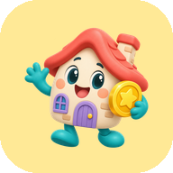

# TaskDira

### Same home. New game. 🏠🎮

**TaskDira turns household chores into a game the whole home plays together.**<br/>
Each chore is a quest that earns XP and coins. The family spends coins in a shared reward shop and climbs a monthly leaderboard. Everyone sees it all happen live.


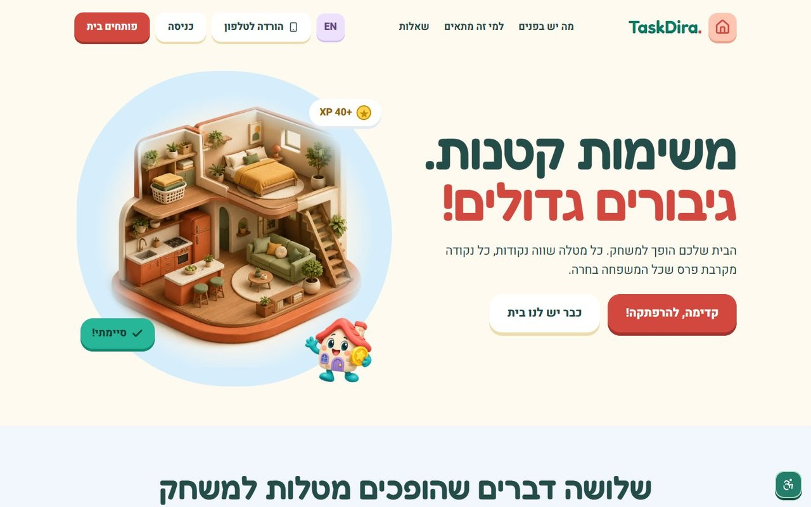

</div>

---

## ✨ Why TaskDira

Nobody fights over a game. TaskDira gives every chore a reward and every member a place on the podium. The home keeps a shared monthly goal, so families, couples and roommates stop nagging and start playing.

| 🗺️ Quest road | 🪙 Earn and spend | 🏆 Compete together | ⚡ Live |
|:---:|:---:|:---:|:---:|
| Chores become stops on a golden road | XP for progress, coins for rewards | A monthly podium and a household goal | Everyone sees changes in about 0.1 s |

## 📸 A look inside

<table>
  <tr>
    <td width="50%">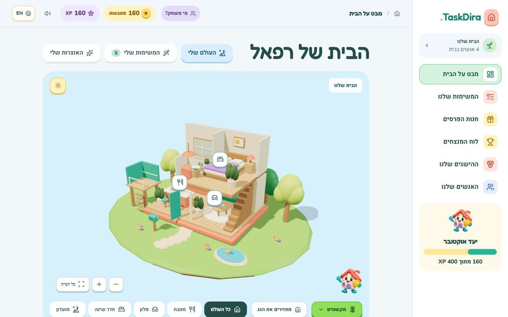<p align="center"><b>Home</b>: the family world and today's missions</p></td>
    <td width="50%">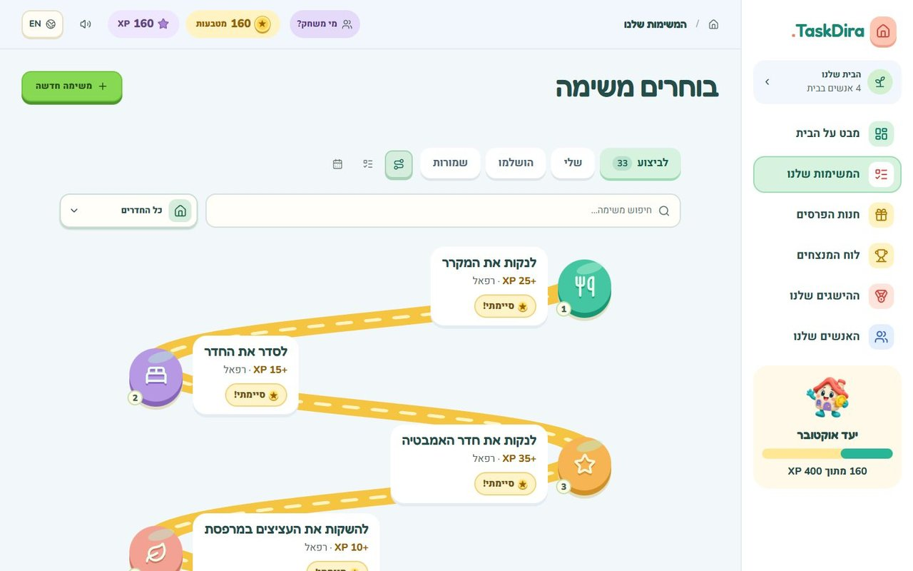<p align="center"><b>Quest road</b>: chores on a golden path</p></td>
  </tr>
  <tr>
    <td width="50%">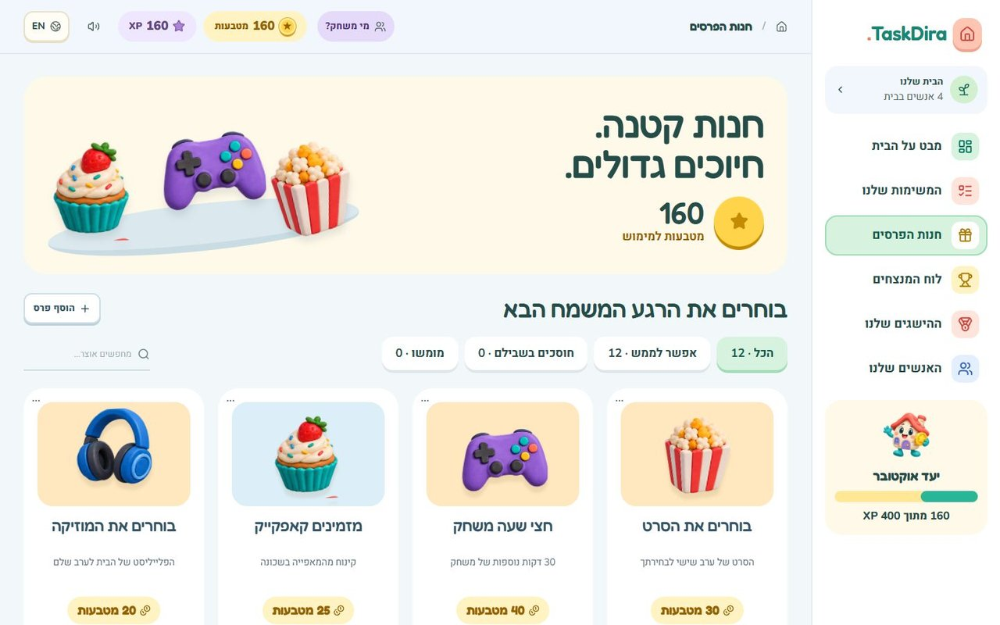<p align="center"><b>Reward shop</b>: spend the coins you earned</p></td>
    <td width="50%">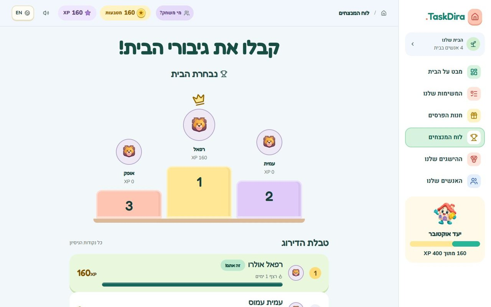<p align="center"><b>Leaderboard</b>: the monthly podium</p></td>
  </tr>
</table>

### 📱 Made for phones too

<p align="center">
  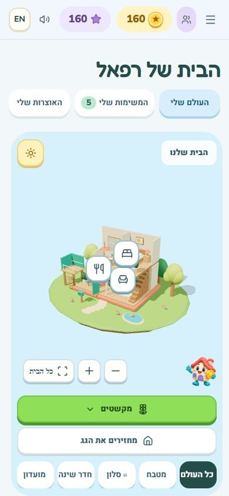
  &nbsp;&nbsp;
  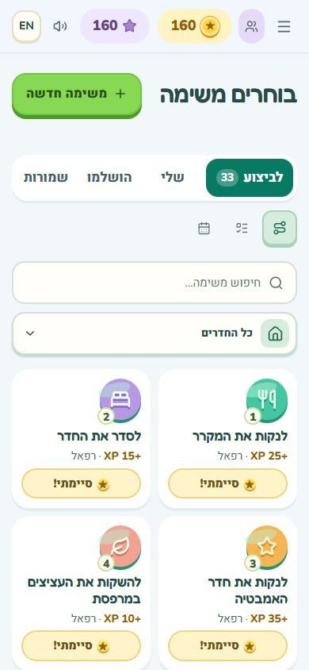
  &nbsp;&nbsp;
  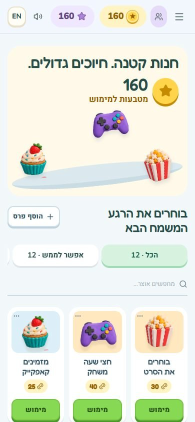
</p>

Phone screens use 2- and 3-up card grids, a bottom tab bar and a menu that fits without scrolling. You can install TaskDira on your home screen straight from the landing page.

---

## 🎮 The game loop

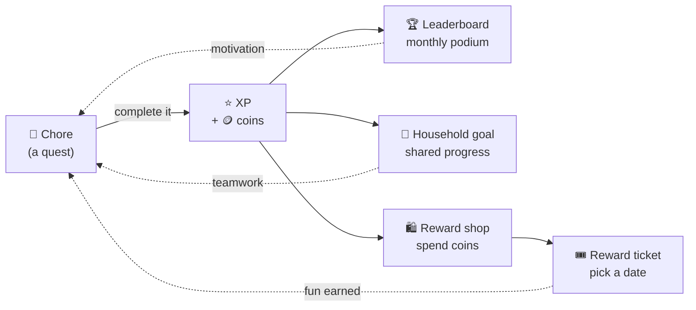

## 🧩 Features at a glance

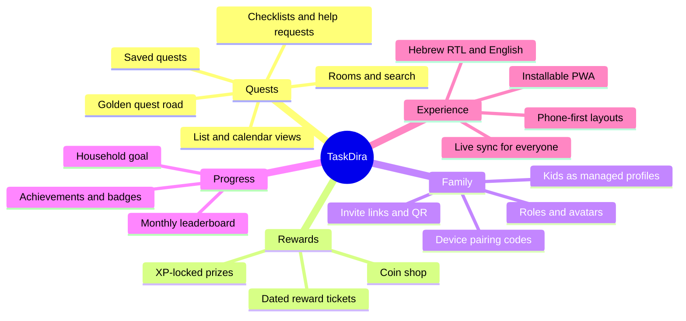

---

## 🏗️ Architecture

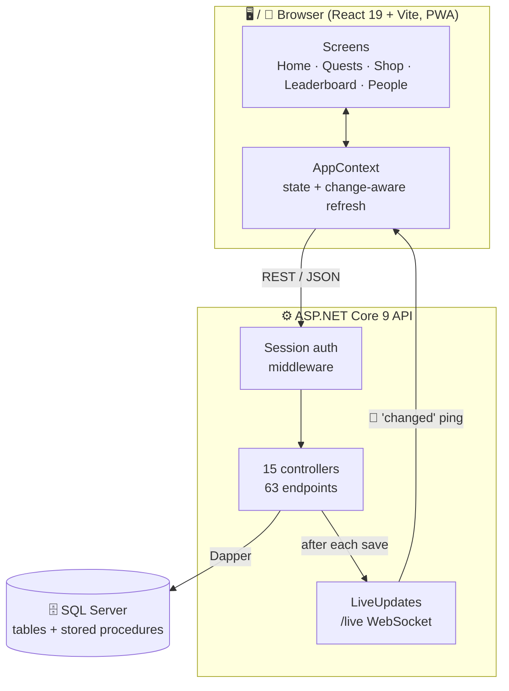

### ⚡ How live updates work

When anyone saves something, every open screen refreshes almost at once. The ping never carries the data itself; each screen fetches the new data through the normal API.

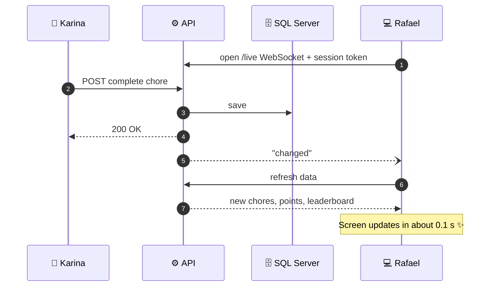

If the socket drops, the app reconnects on its own. A 5-second poll stays as a backup.

### 💌 Joining a family

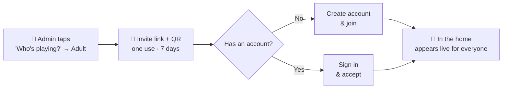

---

## 📊 By the numbers

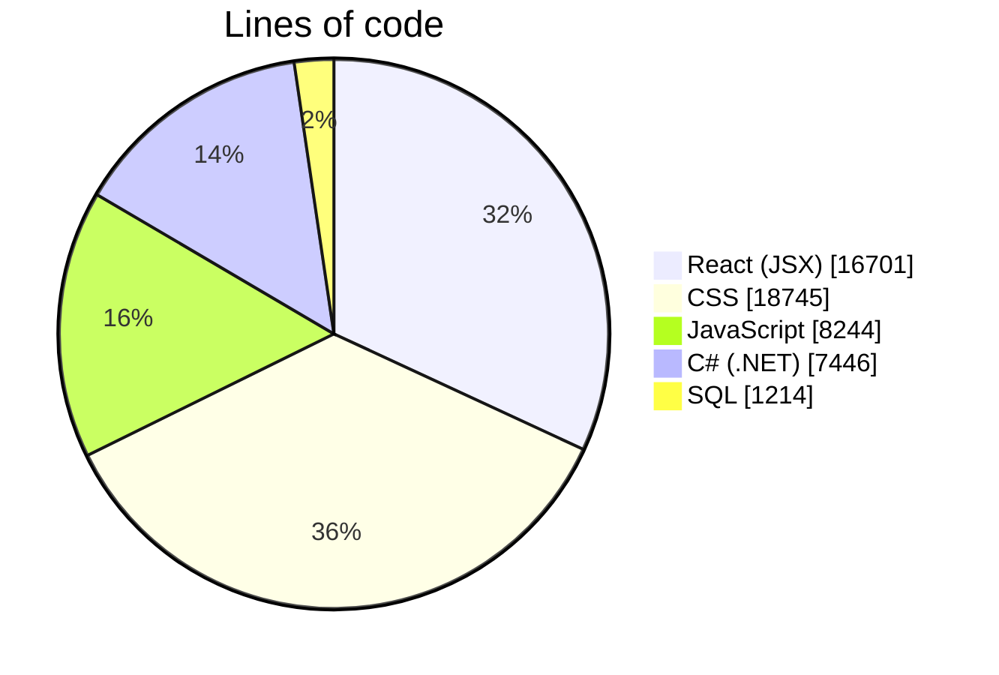

| 13 | 50 | 15 | 63 | 680+ |
|:---:|:---:|:---:|:---:|:---:|
| screens | UI components | API controllers | endpoints | Hebrew/English strings |

---

## 🧰 Tech stack

| Layer | Tech |
|---|---|
| **Frontend** | React 19, Vite 8, Tailwind CSS 4, layered CSS (`src/redesign.css` is the final polish layer), PWA (manifest + service worker) |
| **Backend** | ASP.NET Core (.NET 9) Web API, Dapper, stored procedures, raw WebSockets for live updates |
| **Database** | SQL Server (`Backend/db/sqlserver`). PostgreSQL is also supported (`Backend/db/migrations`). |
| **Languages** | Hebrew (RTL) and English, switchable anywhere |

```
TaskDira/
├── Frontend/              React app (Vite)
│   ├── src/pages/         Screens: Home, Rewards, Leaderboard, Household, Landing, ...
│   ├── src/components/    UI building blocks
│   ├── src/context/       App, auth, household, i18n state
│   ├── src/services/      API clients, install prompt, ...
│   └── public/            PWA manifest, service worker, icons
├── Backend/
│   ├── src/TaskDira.Api/  Controllers, services, repositories, Program.cs
│   ├── db/sqlserver/      000–005 schema + stored procedures
│   └── tests/
└── docs/screenshots/      Images used in this README
```

---

## 🚀 Run it locally

You need the **.NET 9 SDK**, **Node.js 20+** and **SQL Server** (Express is fine).

**1. Database.** Create an empty database and run `Backend/db/sqlserver/000_preflight.sql` → `005_family_play.sql` in order, for example in SSMS.

In Development, if no connection string is set, the API uses `.\SQLEXPRESS` with the database `TaskDira_MigrationDev` and Windows authentication. To use another server:

```bash
dotnet user-secrets set "ConnectionStrings:TaskDiraSqlServer" "Server=...;Database=...;..." --project Backend/src/TaskDira.Api
```

**2. API** (http://localhost:5188):

```bash
dotnet run --project Backend/src/TaskDira.Api --no-launch-profile -- --environment Development --Database:Provider SqlServer --urls http://localhost:5188
```

> ⚠️ Always pass `Database:Provider SqlServer`. Without it, the API expects PostgreSQL and won't start.

**3. Web app** (http://localhost:3000):

```bash
cd Frontend
npm ci
npm run dev
```

The app calls `http://localhost:5188` by default. Set `VITE_API_URL` to point it elsewhere.

> 💡 **No backend?** `npm run demo` starts a sample household that lives entirely in the browser (port 3001).

**Tests and build:**

```bash
cd Frontend && npm test && npm run build
dotnet build Backend/TaskDira.sln
```

---

## ☁️ Deploying

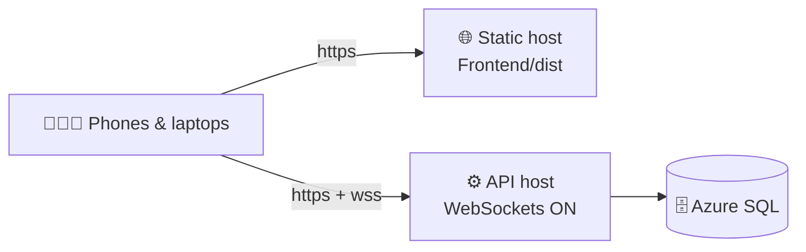

1. **Database**: a hosted SQL Server, such as Azure SQL. You can copy a local database with SSMS: *Tasks → Deploy Database to Microsoft Azure SQL Database*.
2. **API**: for example Azure App Service, with these settings:
   - `Database__Provider=SqlServer`
   - `ConnectionStrings__TaskDiraSqlServer=<connection string>`
   - `Cors__AllowedOrigins__0=https://<your-site>`
   - **WebSockets turned on**, for live updates
3. **Web app**: build with `VITE_API_URL=https://<your-api>` (`npm run build`) and serve `Frontend/dist` from any static host with https, such as Azure Static Web Apps, Netlify or Vercel.

> Invite links and "install on your phone" need https on the public address.

---

## 📚 More docs

| Doc | What's in it |
|---|---|
| [PRODUCT.md](PRODUCT.md) | Product overview |
| [DESIGN.md](DESIGN.md) | Design system |
| [FAMILY-SETUP.md](FAMILY-SETUP.md) | Family profiles, invitations, adventures |
| [RUN-THE-REDESIGN.md](RUN-THE-REDESIGN.md) | Exploring the redesign |
| [Backend/CLAUDE.md](Backend/CLAUDE.md) | Backend notes |

<div align="center">

**Made with 💚 by the TaskDira team**

</div>
